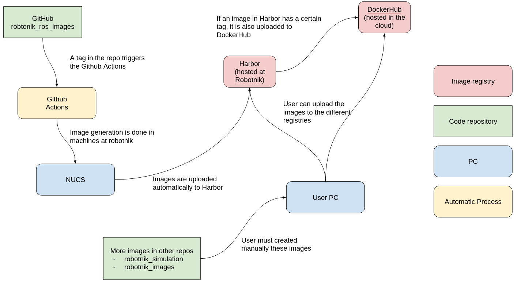

# Robotnik ROS images

This repository contains the configurations for generating Robotnik ROS Docker images using **Docker Compose** and delivering them to our registries.

The configuration files are created with the **yq** template engine.

These images are used as base images for the Robotnik software, as well as for building and testing ROS packages.

The images are created for the different ROS distros (Melodic, Noetic, Humble, Iron, Jazzy, Rolling, etc)

## Repository structure

| folder | description |
| --- | --- |
| [`resources`](./resources) | Contains the basic images, used to build other images |
| [`examples`](./examples)  | Contains example images, used to demonstrate the usage of the basic images |
| [`build.sh`](./build.sh) | Script to build the basic images for the different ROS distros |
| [`.github`](./.github) | Configuration of Github Actions and Workflows to automate the build and push of the images |

## Basic Images

In the [resources](./resources) folder we find three basic images:

- [base](./resources/base): Image with ROS installed and some utilities from Robotnik
- [builder](./resources/builder): Based on **base**, includes tools to compile source code and generate deb packages
- [gui](./resources/gui): Based on **base**, includes tools to serve graphical applications via VNC

## Automatic Image Generation

We have setup the automatic generation of the images for the following ROS distros:

| ROS version | ROS distro | Image name |
| ----------- | ---------- | ---------- |
| 1           | Melodic    | `melodic`  |
| 1           | Noetic     | `noetic`   |
| 2           | Humble     | `humble`   |
| 2           | Iron       | `iron`     |
| 2           | Jazzy      | `jazzy`    |
| 2           | Rolling    | `rolling`  |

The images are tagged with the ROS version, type, version or commit hash, and date. For example, `noetic-base-0.1.0-20200818` is the image with ROS1 Melodic, type `base`, version `0.1.0` and date `20200818`. The image without version and date is the latest version of the image.

This configuration is stored in the [.github](./.github) folder.

## Registries

The images are stored in the following registries:

| Registry | Images |
| --- | --- |
| [Harbor](https://registry.robotnik.ws) | `robotnik/ros:<distro>-<type>` |
| [Docker Hub](https://hub.docker.com/r/robotnik/ros) | `robotnik/ros:<distro>-<type>` |

## Examples

All the examples are in the [examples](./examples) folder.

### ROS1

- [Basic](./examples/ros1/basic)
- [Sources as installed debian packages](./examples/ros1/generate-and-install-debs-from-source)
- [Generate deb files](./examples/ros1/generate-debs)
- [Rviz through web](./examples/ros1/rviz-web)

### ROS2

- [Basic](./examples/ros2/basic/)
- [Developer workspace](./examples/ros2/devel-workspace)
- [Sources as installed debian packages](./examples/ros2/generate-and-install-debs-from-source)
- [Generate deb files](./examples/ros2/generate-debs)
- [Multiple domains](./examples/ros2/multiple-domains)
- [Nvidia container toolkit](./examples/ros2/nvidia-container-toolkit)
- [Rviz through vnc](./examples/ros2/rviz-vnc)
- [Rviz through web interface](./examples/ros2/rviz-web)

## How images can be created and uploaded to registries

## License

Copyright (c) 2025, Robotnik Automation S.L. All rights reserved.

Licensed under the [BSD 2-Clause](./LICENSE) License.
